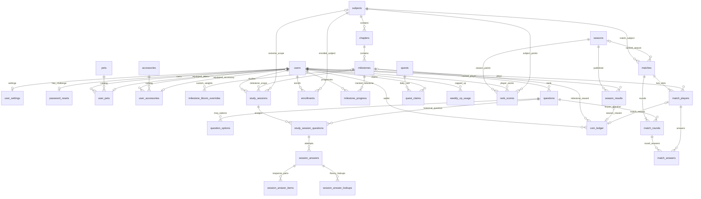

# Thiết kế PostgreSQL V1 · Tháp Tri Thức

**Bước 1, bản chờ duyệt ngày 24/11/2026.** Đích là PostgreSQL local `thaptrithuc_v1` trên nhánh `local-pg-v1`. Thiết kế lấy nghiệp vụ từ [LUAT_NGHIEP_VU.md](LUAT_NGHIEP_VU.md). Quyết định đã chốt gồm ẩn khiên, sát thương chung cho mọi Pet, lưu từng lần làm và chi tiết đối chiếu Admin, giữ thưởng thực nhận theo trận, và chỉ cho mốc thuần lý thuyết hoàn thành qua phần đọc.

Thiết kế dùng các tính năng có trong PostgreSQL 16. Mọi tên vật lý là tiếng Anh, ASCII snake_case và tên bảng số nhiều. Bước này chỉ mô tả schema, cơ chế toàn vẹn và chuẩn kiểm thử. DDL, seed và sửa ứng dụng bắt đầu sau các điểm duyệt đã nêu trong yêu cầu.

## Các quyết định cần thấy khi duyệt

| Điểm khác khung ban đầu | Thiết kế đề xuất và căn cứ |
|---|---|
| **HP và tổng sát thương** | HP thực ra suy được từ 100 HP ban đầu, sát thương đã ghi của đối thủ và trạng thái đầu hàng. Khiên đã ẩn, sát thương không phụ thuộc Pet. Dùng view HP có sàn 0. Đây là chỗ chủ động bỏ cột `match_players.hp` để theo P2. Test sẽ chặn sát thương âm và xác nhận không thể ghi HP tùy ý qua view. |
| **Xu thực nhận của trận, mùa và mốc** | Sổ Xu là nguồn duy nhất của khoản tiền thực đã cấp. FK có kiểu tới trận/người, mùa/người hoặc mốc cho phép lấy lại đúng khoản trên giao diện. Giữ EXP và delta hạng thực tế trong `match_players`, vì tổng tuần, tổng EXP và điểm hiện tại không tái tạo chúng. Giữ hạng đã công bố trong `season_results`, tính Xu khi đọc từ ledger. |
| **Ngày và trạng thái tiến độ** | `milestone_progress.completed_at` đã phân biệt mở và xong. Cột `status` thứ hai và chuỗi “3/5” được suy trong view. Ngày ghi danh có chức năng sắp xếp nên được giữ. Mốc hoàn thành của môn không tạo thêm cột. |
| **Câu đã phát và các lần trả lời** | Bổ sung quan hệ câu đã phát vì mẫu số chấm gồm cả câu bỏ trống. Lượt có khóa phiên–số lượt để giữ nhiều lần làm cùng câu. Tách dòng token/cặp và nhật ký tra cứu phục vụ Admin. Điều này giữ đủ dữ liệu gốc mà không mở rộng whitelist JSONB. |
| **Google và khôi phục** | Lưu `google_verified_email` riêng vì tài khoản có thể liên kết địa chỉ khác. Hash nullable thay cờ có mật khẩu. Thử thách có một thời điểm hết hạn. Với TTL cố định 10 phút của V1, suy giờ cấp để giới hạn gửi lại 60 giây. |
| **Cấu hình nội dung** | Giữ `milestones.kind` vì nó điều khiển đề boss và mốc lý thuyết. Cấu hình Bloom tùy chỉnh là hàng theo bước với ba tỷ lệ, vì whitelist cấm lưu nó bằng JSONB. Giữ thẻ bước của câu do Admin dùng dù truy vấn đề hiện chủ yếu lọc Bloom. Bỏ mô tả chương khỏi schema và form local nếu thiết kế được duyệt, vì chưa thấy chức năng đọc ngoài việc API trả cả bản ghi. |
| **Giá trị 0 và chấm bước** | Giá/thưởng 0 là giá/thưởng 0. Khi thưởng bước dương, giữ luật phân bổ, làm tròn và sàn hiện hành. Một bước mới chỉ tăng tiến độ nếu bằng bước đang mở. Ôn bước trước vẫn lưu lượt nhưng không trả lại thưởng. Đây là thay đổi chủ ý so với nhánh cũ chấp nhận bước lớn hơn bước đang mở. |
| **Ghi danh và ngày nhiệm vụ** | Giữ khả năng tự ghi danh khi người đã xác thực xem lộ trình và giữ thứ tự mốc. Giữ tiêu chí nhiệm vụ theo code B0, kể cả phiên lưu dở, với tập dữ kiện thực sự đã lưu. Mốc thuần lý thuyết cập nhật tiến độ và thưởng, không tự tạo phiên giả để làm tăng nhiệm vụ. |

## Danh mục vật lý chờ duyệt

| Nhóm | Bảng | Cột |
|---|---:|---:|
| Tài khoản | 3 | 27 |
| Pet và phụ kiện | 4 | 18 |
| Nội dung | 6 | 41 |
| Học tập | 7 | 40 |
| Kinh tế | 4 | 18 |
| Đấu trường | 7 | 33 |
| **Tổng trước DDL** | **31** | **177** |

Quy ước trong danh mục. `?` là cột cho phép NULL, các cột còn lại bắt buộc. `PK` trên nhiều cột biểu thị một khóa ghép. `FK` có thể là thành phần của khóa ghép. Khóa UUID sinh cho thực thể có danh tính riêng và giữ nguyên khi đổi tên. Các quan hệ, suất đấu, hàng phiên và lượt dùng khóa nghiệp vụ ghép. `text` dùng miền CHECK thay vì lưu nhiều dạng enum cũ. Mọi timestamp là `timestamptz` và kết nối định dạng UTC. `date` dùng cho ngày địa phương khi bản chất nghiệp vụ là ngày.

### Tài khoản

#### `users`

Tài khoản người học, quản trị hoặc bot.

- Cột `id uuid PK`, `username text`, `email text`, `display_name text`, `role text`, `password_hash text?`, `google_sub text?`, `google_verified_email text?`, `session_version int`, `disabled_at timestamptz?`, `created_at timestamptz`, `xp int`, `coin_balance int`, `streak_days int`, `last_active_date date?`, `equipped_pet_id text?`, `equipped_accessory_id text?`.
- Ràng buộc và căn cứ giữ cột. UNIQUE username/email đã chuẩn hóa, unique lọc Google sub khi có. CHECK role, số dư/EXP/streak/session_version ≥0, trạng thái streak khớp ngày, sub và email Google cùng có hoặc cùng NULL. FK ghép từ id và mã trang bị tới user_pets/user_accessories, RESTRICT. Tên, role, email và hash phục vụ auth. Email Google riêng dùng khôi phục. Ngày tạo hiện trên Admin. XP, Xu và streak là trạng thái nghiệp vụ. disabled_at được dùng để khóa đăng nhập và ghi thời điểm vô hiệu. Chọn Pet/phụ kiện là dữ kiện khác danh sách sở hữu.
- Đối chiếu `services/auth.service.js:38–72,79–173,220–249`, `services/google-identity.service.js:33–66`, `services/session-validity.service.js:1–6`, `public/admin/index.html:2650`.

#### `user_settings`

Cài đặt đồng bộ của một tài khoản.

- Cột `user_id uuid PK FK`, `theme text`, `sound_enabled bool`, `sound_config jsonb?`, `tutorial_progress jsonb?`.
- Ràng buộc và căn cứ giữ cột. FK users CASCADE. theme LIGHT/DARK. Cờ âm thanh tổng và cấu hình từng kênh có nghĩa riêng. JSONB chỉ là object, áp schema khóa theo tính năng. Hướng dẫn có bước, layout, hoàn thành và context theo tài khoản.
- Đối chiếu `services/auth.service.js:68–71,186–213`, `public/js/account-state.js:28–48`.

#### `password_resets`

Một thử thách còn hiệu lực mỗi tài khoản.

- Cột `user_id uuid PK FK`, `google_sub text`, `code_hash text`, `expires_at timestamptz`, `attempts smallint`.
- Ràng buộc và căn cứ giữ cột. FK users CASCADE. attempts 0..5, code_hash duy nhất theo thử thách ở dạng băm. google_sub là định danh đã xác thực lúc cấp và so lại lúc dùng. Index expires_at để dọn thử thách. Duy nhất một mốc giờ vì TTL cả hai luồng là 10 phút. Mốc gửi gần nhất suy từ expiry trừ TTL. Email Google hiện tại lấy từ users, phiên cấp mã ràng buộc email đã xác minh trong đầu vào băm và xóa thử thách khi đổi liên kết.
- Đối chiếu `services/password-recovery.service.js:27–84`, `services/google-identity.service.js:50–66`.

### Pet và phụ kiện

#### `pets`

Danh mục Pet dùng chung cho shop, admin và hiển thị.

- Cột `id text PK`, `name text`, `description text`, `image_path text`, `price_coins int`, `minimum_level smallint`, `required_role text?`, `status text`.
- Ràng buộc và căn cứ giữ cột. Giá ≥0, cấp ≥1, role ADMIN hoặc NULL, status ACTIVE/ARCHIVED. Index (status,price_coins,id) cho shop. Giữ mã và ảnh theo seed danh mục. Tên, mô tả, ảnh có người dùng. ARCHIVED chặn bán mới, Pet đã mua vẫn hiện và dùng được nếu đủ quyền. Phần công thức sát thương độc lập Pet.
- Đối chiếu `services/pet.service.js:27–77`, `config/pets.json:2–156`, `public/index.html:3452–3475,8433–8438`.

#### `accessories`

Danh mục phụ kiện cosmetic, mua và trang bị độc lập.

- Cột `id text PK`, `name text`, `description text`, `price_coins int`, `minimum_level smallint`, `status text`.
- Ràng buộc và căn cứ giữ cột. Giá ≥0, cấp ≥1. ACTIVE/ARCHIVED. Seed mũ Sparky 50 Xu ở ARCHIVED để bảo toàn trạng thái khóa, cấp mặc định 1 vì nguồn không giới hạn. Phụ kiện ARCHIVED không mua/đội được, có thể tháo. Demo kiểm luồng mua có một mẫu ACTIVE riêng trong dữ liệu test. Index (status,price_coins,id).
- Đối chiếu `config/accessories.json:2`, `services/inventory.service.js:6–37`, `public/js/inventory.js:64–145`.

#### `user_pets`

Một quyền sở hữu Pet của người dùng.

- Cột `user_id uuid PK FK`, `pet_id text PK FK`.
- Ràng buộc và căn cứ giữ cột. FK users và pets RESTRICT. PK người–Pet chống cấp/mua trùng. Index pet_id theo chiều ngược. FK trang bị của users trỏ vào cặp này. Không lưu ngày sở hữu hay cờ kích hoạt.
- Đối chiếu `services/pet.service.js:22–26,37–41,52–77`, `services/auth.service.js:120–125`.

#### `user_accessories`

Một quyền sở hữu phụ kiện của người dùng.

- Cột `user_id uuid PK FK`, `accessory_id text PK FK`.
- Ràng buộc và căn cứ giữ cột. FK users và accessories RESTRICT. PK người–phụ kiện, index accessory_id. FK trang bị của users trỏ vào cặp này. Hiển thị đã sở hữu và kiểm điều kiện đội.
- Đối chiếu `services/inventory.service.js:6–37`.

### Nội dung

#### `subjects`

Môn trên kho môn, lộ trình, phòng đấu và Cực Hạn.

- Cột `id uuid PK`, `slug text`, `name text`, `description text?`, `sort_order int`, `status text`.
- Ràng buộc và căn cứ giữ cột. UNIQUE slug. CHECK slug ASCII dạng chữ thường, số, gạch ngang, thứ tự ≥0. Index (status,sort_order,id). Slug phục vụ URL, mã dùng FK. Tên, mô tả và thứ tự có UI đọc. Môn ngừng độc lập theo trạng thái.
- Đối chiếu `services/course.service.js:24,68–70,181–190`, `public/index.html:3841–3940`, `services/admin.service.js:46–69`.

#### `chapters`

Chương nằm trong một môn.

- Cột `id uuid PK`, `subject_id uuid FK`, `title text`, `sort_order int`, `status text`.
- Ràng buộc và căn cứ giữ cột. FK subjects RESTRICT, UNIQUE (subject_id,sort_order), thứ tự ≥0. Giữ cờ độc lập để quản trị ngừng riêng chương theo chính sách đã chốt. Tên và thứ tự có UI đọc. Form mô tả chương bị bỏ theo thiết kế vì chưa thấy giao diện tiêu thụ nội dung đó.
- Đối chiếu `services/course.service.js:190–217`, `services/admin.service.js:75–98`, `public/js/learning-garden.js:21–46`.

#### `milestones`

Một mục học thuần lý thuyết, luyện tập hoặc boss.

- Cột `id uuid PK`, `chapter_id uuid FK`, `title text`, `kind text`, `theory_markdown text?`, `status text`, `sort_order int`, `reward_xp int`, `reward_coins int`, `step_count smallint`, `questions_per_step smallint`.
- Ràng buộc và căn cứ giữ cột. FK chapters RESTRICT. UNIQUE (chapter_id,sort_order). kind THEORY/QUIZ/BOSS. Thứ tự và thưởng ≥0. THEORY dùng 0 bước và 0 câu mỗi bước. QUIZ/BOSS dùng cả hai >0. Loại quyết định cách lấy đề và điều kiện hoàn thành. Thưởng và số lượng được đọc khi cấp đề/chấm thưởng. Tên, lý thuyết và thứ tự được hiển thị.
- Đối chiếu `services/course.service.js:203–217,269–431,832–925`, `public/admin/index.html:725–747`.

#### `milestone_bloom_overrides`

Trọng số Bloom tùy chỉnh cho một bước, nếu có.

- Cột `milestone_id uuid PK FK`, `step_no smallint PK`, `remember_pct smallint`, `understand_pct smallint`, `apply_pct smallint`.
- Ràng buộc và căn cứ giữ cột. FK milestones CASCADE vì đây là cấu hình con thuần. CHECK các tỷ lệ 0..100 và tổng 100. Trigger khóa mốc và kiểm bước 1..step_count khi sửa tỷ lệ/số bước. Thiếu dòng dùng hồ sơ mặc định từ luật Bước 0, không lưu bản sao mặc định.
- Đối chiếu `services/course.service.js:269–354,416–431`.

#### `questions`

Một phiên bản câu dùng được trong học, arena và Cực Hạn.

- Cột `id uuid PK`, `milestone_id uuid FK`, `type text`, `bloom_level text`, `step_no smallint`, `difficulty smallint`, `stem text`, `explanation text?`, `status text`, `payload jsonb?`.
- Ràng buộc và căn cứ giữ cột. FK milestones RESTRICT. Index (milestone_id,status,bloom_level) cho chọn đề. CHECK enums bên dưới, step_no ≥1, difficulty 1..3. stem/explanation là nội dung hiển thị và chấm. step_no là nhãn admin hiện sửa, không dùng khóa khác thay nó. JSONB giữ dữ liệu chấm phi trắc nghiệm. MCQ dùng NULL và bảng options. Nội dung đáp án chỉ xuất sau chấm hoặc cho Admin.
- Đối chiếu `services/course.service.js:397–486`, `services/arena.service.js:298–350`, `services/extreme.service.js:68–133`, `public/admin/index.html:2176–2283`.

#### `question_options`

Một phương án trắc nghiệm tự nhiên theo vị trí.

- Cột `question_id uuid PK FK`, `position smallint PK`, `text text`, `is_correct bool`.
- Ràng buộc và căn cứ giữ cột. FK questions RESTRICT. position 0..3 và text có nội dung. Unique lọc question_id khi is_correct. Trigger hoãn kiểm đúng 4 phương án và đúng 1 lựa chọn đúng cho câu MCQ, 0 phương án cho loại khác. Phương án và dấu đúng là nguồn chấm có thật, không lưu chỉ số đáp án đúng ở questions.
- Đối chiếu `core/rules/progression.rules.js:89–99`, `services/course.service.js:476–486`.

### Học tập

#### `enrollments`

Ghi danh của người học ở một môn.

- Cột `user_id uuid PK FK`, `subject_id uuid PK FK`, `enrolled_at timestamptz`.
- Ràng buộc và căn cứ giữ cột. FK users, subjects RESTRICT. Index (user_id,enrolled_at DESC) cho hồ sơ, index subject_id cho tra môn. Ngày ghi danh có thể trước phiên đầu và đang dùng để sắp xếp. Trạng thái hoàn thành và tỷ lệ môn tính từ tiến độ.
- Đối chiếu `services/course.service.js:68–109,141–175`, `routes/profile.routes.js:7–14`.

#### `milestone_progress`

Tiến độ hiện hành và EXP thực nhận theo mốc.

- Cột `user_id uuid PK FK`, `milestone_id uuid PK FK`, `current_step smallint?`, `xp_earned int`, `completed_at timestamptz?`, `memory jsonb?`.
- Ràng buộc và căn cứ giữ cột. FK users/milestones RESTRICT. Index (user_id,completed_at) và milestone_id. Không có dòng là khóa, đã có dòng là mở, completed_at có giá trị là đã xong. Tránh lặp cột status và chuỗi số bước. current_step chỉ cần ở QUIZ/BOSS chưa xong. Trigger khóa mốc/ghi danh để kiểm phạm vi và step. EXP là khoản thực đã ghi theo mốc. Xu xem từ ledger có milestone_id. memory JSONB object per-question dùng ôn thích nghi.
- Đối chiếu `services/course.service.js:220–248,619–745,832–925`, `public/admin/index.html:2850–2875,2910–2934`.

#### `study_sessions`

Định danh phiên dùng để chấm, chốt và mở lại lịch sử.

- Cột `id uuid PK`, `user_id uuid FK`, `kind text`, `milestone_id uuid? FK`, `subject_id uuid? FK`, `step_no smallint?`, `started_at timestamptz?`, `finished_at timestamptz?`, `finish_kind text?`.
- Ràng buộc và căn cứ giữ cột. FK users, milestones, subjects RESTRICT. Cực Hạn theo môn, started_at có thật để đo wall-clock. Phiên khác chỉ trỏ mốc, started_at NULL. Chỉ loại STEP có step_no. finished_at cho ngày học, nhiệm vụ, Admin và nhập chốt đúng một lần. finish_kind phân biệt SUBMITTED/ABANDONED, chỉ STEP được abandon. Cặp finish_kind và finished_at cùng NULL khi đang làm. Index (user_id,finished_at DESC), (milestone_id,step_no), subject_id.
- Đối chiếu `services/course.service.js:607–615,804–815,1034–1045`, `services/extreme.service.js:142–177,332–359`, `routes/profile.routes.js:15–17`.

#### `study_session_questions`

Danh sách câu chính thức được phát trong phiên.

- Cột `session_id uuid PK FK`, `position int PK`, `question_id uuid FK`.
- Ràng buộc và căn cứ giữ cột. FK session và câu RESTRICT. UNIQUE (session_id,question_id), position ≥1 và bất biến sau khi phát. Index question_id. Chứng minh phạm vi chấm và tổng số câu, kể cả bài bỏ trống. Khóa câu và kiểm môn/mốc/chương thích hợp khi lập phiên.
- Đối chiếu `services/course.service.js:391–440,526–569`, `core/rules/progression.rules.js:23–46`, `services/extreme.service.js:44–62`.

#### `session_answers`

Một lượt trả lời thực tế, kể cả lần thử lại cùng câu.

- Cột `session_id uuid PK FK`, `attempt_no int PK`, `question_position int FK`, `is_correct bool`, `seconds numeric(10,3)?`, `selected_option_position smallint?`, `submitted_text text?`.
- Ràng buộc và căn cứ giữ cột. FK ghép (session_id,question_position) tới câu đã phát RESTRICT. attempt_no ≥1, seconds ≥0 nếu có, selected_option_position 0..3 nếu có. Trigger kiểm phương án thuộc câu đã phát. Lưu chỉ số khi là đáp án gốc MCQ, text khi điền từ hoặc Cực Hạn dùng lựa chọn chuyển thể. Nội dung cùng loại không ghi cả hai. Số lần tra cứu tính từ các dòng chi tiết. Không tạo lượt giả cho câu bỏ trống.
- Đối chiếu `public/index.html:7077–7080,7124–7136,8355–8382`, `services/admin.service.js:311–367`, `services/extreme.service.js:353–359`.

#### `session_answer_items`

Token đã sắp hoặc cặp đã nối của một lượt học.

- Cột `session_id uuid PK FK`, `attempt_no int PK FK`, `item_no int PK`, `value_text text`, `paired_value_text text?`.
- Ràng buộc và căn cứ giữ cột. FK ghép tới session_answers CASCADE vì dòng con thuần của lượt. CHECK item_no ≥1. Trigger kiểm kiểu câu. ORDERING có token và cặp thứ hai NULL. MATCHING dùng cả hai vế. Với các hình thức còn lại không có dòng con này. Admin dựng lại câu làm theo thứ tự mục.
- Đối chiếu `public/admin/index.html:2771–2824`, `core/rules/progression.rules.js:49–88`.

#### `session_answer_lookups`

Từng lần mở lý thuyết để tra cứu trong câu.

- Cột `session_id uuid PK FK`, `attempt_no int PK FK`, `lookup_no int PK`, `opened_at timestamptz`, `duration_seconds int`, `offset_seconds int`, `context text`.
- Ràng buộc và căn cứ giữ cột. FK ghép tới lượt CASCADE. lookup_no ≥1, duration_seconds ≥1, offset_seconds ≥0, context BEFORE_ANSWER/AFTER_ANSWER. Thời điểm xảy ra, thời lượng và khoảng cách từ xung bắt đầu câu là telemetry gốc, đều có luồng hiển thị/phân tích. View COUNT dùng thay cho số lượt tra cứu lưu riêng.
- Đối chiếu `public/index.html:8355–8382`, `services/admin.service.js:365–366,700–702`, `public/admin/index.html:2790–2822`.

### Kinh tế

#### `quests`

Định nghĩa ba nhiệm vụ có chu kỳ ngày.

- Cột `code text PK`, `reward_coins int`, `reward_xp int`.
- Ràng buộc và căn cứ giữ cột. CHECK ba mã STUDY/BATTLE/PET_CARE và thưởng ≥0. Seed từ luật B0. Điều kiện thao tác do hàm claim kiểm ở DB. Quà tân thủ có quy tắc một lần riêng và không lặp theo ngày.
- Đối chiếu `services/quest.service.js:5–28`.

#### `quest_claims`

Bằng chứng đã nhận một nhiệm vụ trong ngày Việt Nam.

- Cột `user_id uuid PK FK`, `quest_code text PK FK`, `vn_date date PK`.
- Ràng buộc và căn cứ giữ cột. FK users/quests RESTRICT. Index (vn_date,quest_code) cho báo cáo ngày và quest_code cho FK. vn_date lấy một lần từ thời điểm UTC do DB chọn lúc xử lý. Không cần thêm claimed_at vì UI chỉ quan tâm ngày. Chỉ hàm cấp thưởng được ghi khi đủ điều kiện.
- Đối chiếu `services/quest.service.js:7–39`, `public/index.html:8690–8725`.

#### `weekly_xp_usage`

EXP thi đấu đã được cấp trong tuần của một người.

- Cột `user_id uuid PK FK`, `week_start date PK`, `xp int`.
- Ràng buộc và căn cứ giữ cột. FK users RESTRICT. CHECK week_start là thứ Hai, xp 0..1500. Key người–tuần chặn trùng trạng thái. Append lịch nhiều tuần chỉ là kết quả tự nhiên của khóa tuần. XP tổng gồm nhóm ngoài quota, không dùng thay xp của tuần.
- Đối chiếu `services/economy.service.js:99–124`, `public/index.html:3066–3067`.

#### `coin_ledger`

Sổ Xu nguồn chuẩn cho mọi khoản cộng và trừ.

- Cột `id bigint identity PK`, `user_id uuid FK`, `kind text`, `delta int`, `occurred_at timestamptz`, `note text?`, `match_id uuid? FK`, `milestone_id uuid? FK`, `season_no int? FK`.
- Ràng buộc và căn cứ giữ cột. FK user RESTRICT. FK ghép (match_id,user_id) tới match_players và (season_no,user_id) tới season_results, FK milestone_id tới milestones, đều RESTRICT. Ref khác NULL theo kind. Chỉ MATCH_REWARD có match_id, chỉ SEASON_REWARD có season_no, chỉ MILESTONE_REWARD có milestone_id. Mua âm, thưởng dương, PET_FEED âm, PET_STROKE bằng 0, ADMIN_ADJUSTMENT khác 0. ID tách các sự kiện có thể cùng người và timestamp. Giờ dùng cho ngày nhiệm vụ/histories. Note giữ lý do Admin nhập và mô tả nghiệp vụ, không chứa khóa dùng để JOIN. Index (user_id,occurred_at DESC,id DESC), index refs và unique lọc mỗi trận, mỗi mùa, mỗi quà tân thủ.
- Đối chiếu `services/economy.service.js:51–90,135–139`, `services/quest.service.js:14–53`, `services/admin.service.js:290–291,777–780`, `services/arena.service.js:503–509`, `services/arena-season.service.js:52–57`.

### Đấu trường

#### `seasons`

Trạng thái chốt theo số mùa xác định trong lịch 56 ngày.

- Cột `season_no int PK`, `is_closed bool`.
- Ràng buộc và căn cứ giữ cột. Số mùa ≥1. Unique lọc trên hằng số khi chưa đóng bảo đảm tối đa một mùa mở. Mốc bắt đầu/kết thúc đọc từ lịch V1, không lưu chồng. is_closed là dấu chốt thực phục vụ mở lại và chịu lỗi khi trả thưởng.
- Đối chiếu `services/arena-season.service.js:5–25,50–68`.

#### `rank_scores`

Điểm đang dùng và điểm khóa của một người trong một môn theo mùa.

- Cột `user_id uuid PK FK`, `subject_id uuid PK FK`, `season_no int PK FK`, `points int`.
- Ràng buộc và căn cứ giữ cột. FK users/subjects/seasons RESTRICT, points ≥0. Index (season_no,subject_id,points DESC) và (season_no,user_id). Đóng mùa thì điểm mùa đó giữ nguyên. Điểm là trạng thái có chuyển điểm đầu mùa, khác tổng delta của trận trong mùa. Tổng theo mọi môn tính SUM khi đọc.
- Đối chiếu `services/arena.service.js:490–505`, `services/arena-season.service.js:28–61`, `routes/arena.routes.js:42–109`.

#### `season_results`

Hạng đã công bố của một người đủ điều kiện khi chốt mùa.

- Cột `season_no int PK FK`, `user_id uuid PK FK`, `rank int`.
- Ràng buộc và căn cứ giữ cột. FK seasons/users RESTRICT. CHECK rank ≥1, chấp nhận đồng hạng. Index (season_no,rank) và (user_id,season_no DESC). Lưu hạng đã công bố. Xu chốt mùa đọc từ ledger có FK tới kết quả, điểm đọc từ rank_scores đã khóa.
- Đối chiếu `services/arena-season.service.js:20–57`, `routes/profile.routes.js:18–23`.

#### `matches`

Trận 1v1 đã mở và kết quả vòng đời của nó.

- Cột `id uuid PK`, `subject_id uuid FK`, `season_no int? FK`, `mode text`, `status text`, `started_at timestamptz`, `finished_at timestamptz?`, `finish_reason text?`.
- Ràng buộc và căn cứ giữ cột. FK subjects/seasons RESTRICT. Mode RANKED/CASUAL/PRACTICE. Trạng thái ACTIVE/FINISHED/CANCELLED. ACTIVE không có giờ/lý do chốt. Trạng thái cuối bắt buộc giờ và lý do hợp lệ. Chỉ trận RANKED FINISHED gắn mùa, trigger kiểm finished_at trong đúng cửa sổ. started_at dùng đồng hồ hiệp đầu. finished_at dùng nhiệm vụ, bảng hạng và rollover. Index (season_no,subject_id,finished_at), (status,finished_at). Người thắng lấy từ match_players.
- Đối chiếu `services/arena.service.js:15–29,284–296,442–509`, `services/quest.service.js:16–17`.

#### `match_players`

Hai suất của một trận và khoản thực cấp theo từng người.

- Cột `match_id uuid PK FK`, `slot smallint PK`, `user_id uuid FK`, `result text?`, `xp_awarded int`, `rating_delta int`.
- Ràng buộc và căn cứ giữ cột. FK matches/users RESTRICT. CHECK slot 1/2, xp_awarded ≥0. UNIQUE (match_id,user_id), unique lọc match_id khi WIN. Index (user_id,match_id). Trận mở/hủy không có result và thưởng. Chốt có WIN/LOSE hoặc DRAW/DRAW. XP thực nhận và delta có thể âm ở phần hạng, không suy được từ tổng tuần/điểm hiện tại. Xu từ ledger, HP từ view.
- Đối chiếu `services/arena.service.js:442–509`, `public/index.html:4925–4951,5041`.

#### `match_rounds`

Một câu được chọn ở một hiệp trong trận.

- Cột `match_id uuid PK FK`, `round_no smallint PK`, `question_id uuid FK`.
- Ràng buộc và căn cứ giữ cột. FK matches/questions RESTRICT. round_no 1..10, UNIQUE (match_id,question_id). Index question_id. Trigger kiểm đề thuộc môn trận, câu đang hoạt động lúc phát và hiệp liên tiếp. Lưu lịch sử câu bằng FK tới phiên bản bất biến.
- Đối chiếu `services/arena.service.js:58–89,113–120`.

#### `match_answers`

Lượt chấm của một suất trong một hiệp.

- Cột `match_id uuid PK FK`, `round_no smallint PK FK`, `slot smallint PK FK`, `is_correct bool`, `response_seconds numeric(10,3)`, `damage int`, `answered_at timestamptz`.
- Ràng buộc và căn cứ giữ cột. Hai FK ghép tới round và player cùng match_id, RESTRICT. CHECK seconds và damage ≥0. Index (match_id,slot,round_no). is_correct, thời lượng và sát thương là kết quả server đã ghi khi chấm. answered_at làm mốc hiệp kế. Không giữ chỉ số lựa chọn vì lịch sử arena không hiển thị nó, khác Admin học.
- Đối chiếu `services/arena.service.js:236–296,351–425`, `routes/arena.routes.js:72–109`.

## Miền nghiệp vụ và cơ chế kiểm tại DB

### Tài khoản, trang bị và thời gian

- Vai trò `LEARNER/ADMIN/SYSTEM`. SYSTEM dành cho bot nội bộ, không đăng nhập qua HTTP hoặc OAuth. Với tài khoản người thật, CHECK yêu cầu ít nhất một trong hash và Google sub. Chuẩn hóa tên đăng nhập, email và email Google về chữ thường trước lưu. UNIQUE của username/email dựa trên dữ liệu đã chuẩn hóa. Nếu email Google đã liên kết có nhiều tài khoản do dữ liệu ngoài dự kiến, luồng recovery phải xác định ứng viên duy nhất và từ chối khi không xác định được.
- Tạo người dùng trong một transaction theo thứ tự người dùng với hai slot trang bị NULL, user_settings, cấp Sparky qua user_pets, rồi UPDATE slot Pet. FK ghép dùng MATCH SIMPLE nên NULL hợp lệ. Khi đổi Pet, sửa slot bằng đúng cặp sở hữu. Khi muốn xóa quyền sở hữu đang trang bị, FK chặn đến khi đổi hoặc tháo. Việc xóa cứng tài khoản có lịch sử bị RESTRICT, quyền runtime cũng không cho xóa người dùng. Vô hiệu hóa cập nhật `disabled_at` và tăng `session_version` để các phiên cũ không tiếp tục ghi. [Tài liệu PostgreSQL về FK và CHECK](https://www.postgresql.org/docs/16/ddl-constraints.html).
- Đăng nhập Google xác minh sub và email của phiên rồi ghi trong transaction. Một thử thách khôi phục gắn `user_id`, sub và email Google xác minh vào đầu vào hash. Ghi hoặc gỡ liên kết và xóa reset đang mở dưới lock người dùng. Chấp nhận reset dưới cùng lock, tăng số lần sai nếu sai, hoặc đổi mật khẩu, tăng phiên bản và tiêu thụ thử thách nếu đúng. Tài khoản đã vô hiệu không tạo hoặc dùng reset. HTTP và Socket.IO đều đối chiếu người dùng hiện tại khi thực hiện hành động cần xác thực.
- `disabled_at`, `expires_at`, `started_at` và `finished_at` là thời điểm UTC trong PostgreSQL. Ngày VN dùng `(instant AT TIME ZONE 'Asia/Ho_Chi_Minh')::date`. Đầu tuần lấy thứ Hai từ datetime đã chuyển sang VN rồi lấy date. Luồng PostgreSQL cấp giờ, frontend chỉ đổi định dạng để hiển thị. Với chốt trận/kỳ, lấy một mốc thời gian sau khi có lock và dùng mốc đó cho cả phép tính và dữ kiện đã lưu. [Tài liệu PostgreSQL về thời gian và múi giờ](https://www.postgresql.org/docs/16/functions-datetime.html).

### Nội dung, đáp án và tính bất biến

- Bảng nội dung và danh mục dùng `ACTIVE/ARCHIVED`. Dòng con hiển thị trong luồng mới khi nó và toàn bộ tổ tiên đều ACTIVE. Cờ con lưu quyết định riêng, việc ngừng môn không ghi đè cờ chương/mốc/câu. Chỉnh nội dung lộ trình giữ ID của môn/chương/mốc và thứ tự unique, không chuyển chương/mốc sang cha khác. Quy tắc không chuyển cha giữ tính đúng của FK và của lịch sử câu theo môn. Mốc đã có lượt hoặc tiến độ giữ loại và số bước. Các phép chỉnh không làm đổi tham chiếu lịch sử vẫn thực hiện qua nghiệp vụ quản trị.
- Câu `MULTIPLE_CHOICE` có bốn hàng `question_options` vị trí 0–3. Unique lọc bảo đảm tối đa một hàng đúng. Constraint trigger DEFERRABLE INITIALLY DEFERRED kiểm số hàng và đúng một phương án đúng khi hoàn tất transaction. Câu phi trắc nghiệm phải có 0 phương án. Trigger chạy trên câu và phương án, ở lúc kiểm hoãn luôn đọc trạng thái cuối. Ghi/chỉnh cấu trúc lấy lock cùng một hàng câu. [Constraint trigger](https://www.postgresql.org/docs/16/sql-createtrigger.html), [partial unique index](https://www.postgresql.org/docs/16/indexes-partial.html).
- `questions.type` là `MULTIPLE_CHOICE/MATCHING/FILL_BLANK/ORDERING`. `bloom_level` là `REMEMBER/UNDERSTAND/APPLY`, chuyển alias THONG_HIEU và PHAN_TICH sang cấp chuẩn của luồng chọn đề. JSONB phi trắc nghiệm là object chuẩn theo loại. MATCHING có `pairs` gồm `left/right` và ít nhất một cặp. FILL_BLANK có `sentence_template`, `options`, `blank_answer` và đúng một chỗ `{blank}`. ORDERING có `prompt`, `correct_order` và `distractors`. Validator DB dùng dữ liệu cùng hàng, xác nhận kiểu và phần tử chuỗi bắt buộc. Dữ liệu seed/admin dùng cùng hình dạng.
- Nội dung và phương án đã phát phải bất biến kể cả phiên đang mở. V1 dùng quy tắc đơn giản cho mọi câu đã ghi. Chỉnh cấu trúc luôn phát hành bản mới và ARCHIVED bản cũ trong một transaction, backend có quyền đổi trạng thái qua hàm thay bản. Hàng option ban đầu được tạo cùng transaction với câu, sau đó option chỉ đọc. RESTRICT từ round/phiên giữ câu cũ. Điều này bảo toàn cả kết quả đã chốt và người làm đang giữ ID đề. Trang quản trị xóa bằng ARCHIVED ở cả bốn cấp. Chỉ phiên và từng lượt hợp lệ được xử lý, đáp án đúng và giải thích không có trong payload phát đề. Học gửi một lượt để server kiểm và trả phản hồi, nên vẫn có phản hồi ngay.
- Khoanh đúng phạm vi đề bằng trigger lúc phát. STEP và MILESTONE đọc câu của mốc, BOSS đọc các mốc cùng chương, EXTREME đọc cùng môn. Kiểm cây trạng thái ACTIVE trong cùng transaction. Phiên đã phát chỉ dùng đúng bộ `study_session_questions`. Khi chấm lại do gửi trùng, khóa phiên và trả kết quả của cùng `attempt_no`. Từ chối gửi trùng khóa với câu hoặc nội dung khác. Dữ liệu trả lời và tra cứu không đổi sau chốt, app không có quyền DELETE các hàng lịch sử.
- MCQ thông thường dùng `selected_option_position` và kiểm đã có phương án ở đúng câu đã phát. Với `FILL_BLANK` và lựa chọn chuyển thể của Cực Hạn, lưu text thực người dùng chọn. Với `ORDERING/MATCHING` không chuyển thể, ghi các item theo thứ tự. Constraint trigger hoãn kiểm hình thức phù hợp khi lượt và items được ghi cùng transaction. Lượt hết giờ ghi `is_correct=false`, không nhận option/text/items. Đối chiếu chọn sai khác với hết giờ theo sự hiện diện dữ liệu nộp. Cực Hạn có thể làm lại câu ở vòng sau, vẫn tham chiếu cùng vị trí nguồn và có attempt_no mới.
- Phiên có mốc kéo theo môn qua chương. Phiên EXTREME có subject_id trực tiếp. CHECK row-local dựa trên kind bắt đúng một liên kết và cột bước/started_at đi kèm. Trigger kiểm bước vừa phạm vi cập nhật mốc. Người chưa ghi danh không tạo phiên học có mốc hoặc tiến độ mốc. EXTREME không cần ghi danh. Khách Cực Hạn giữ phiên tạm thời và không ghi lịch sử/thưởng, phù hợp luồng hiện tại.

### Sổ Xu, thưởng, hạn mức

- Hai quyền DB riêng. Role migration sở hữu schema. Role app không có quyền trực tiếp sửa `coin_balance`, hay INSERT/UPDATE/DELETE/TRUNCATE ledger. Hàm ghi sổ nội bộ lấy khóa row người dùng, cập nhật số dư và ghi ledger trong cùng transaction. Các hàm nghiệp vụ được cấp cho app gọi có tập thao tác đã xác định. Hàm nghiệp vụ ghi sổ dùng SECURITY DEFINER với search_path cố định, dùng tên schema rõ ràng và thu EXECUTE của PUBLIC. Thêm trigger chặn UPDATE/DELETE cho ledger để bảo vệ sổ ngay cả khi quyền được cấp nhầm.
- Enum `coin_ledger.kind`. `STREAK_REWARD/MILESTONE_REWARD/MATCH_REWARD/EXTREME_REWARD/PET_PURCHASE/ACCESSORY_PURCHASE/DAILY_QUEST_REWARD/PET_FEED/PET_STROKE/ONBOARDING_REWARD/SEASON_REWARD/ADMIN_ADJUSTMENT`. CHECK kiểm dấu delta và xác định refs cho loại có khóa. Quà miễn phí cấp quyền trực tiếp. Chi ban đầu hoặc seed có số dư dương phải đi qua sổ. Hiển thị số dư hiện tại từ users, còn số dư sau ở lịch sử nếu giữ giao diện thì WINDOW SUM theo thứ tự ID trong phạm vi người dùng. Khóa người dùng trước khi cấp ID bảo toàn thứ tự sổ của cùng tài khoản.
- Nhận nhiệm vụ giữ khóa người dùng. Kiểm các dữ kiện trong khoảng ngày đã tính rồi INSERT quest_claims. Chỉ giao dịch tạo được khóa người–nhiệm vụ–ngày mới cộng thưởng. Trùng key là kết quả đã nhận và không đổi số dư/EXP. Hàm app sử dụng đồng hồ DB. Bản kiểm thử có thể chọn instant bằng đầu vào đặc quyền fixture để kiểm ngày, runtime không có đầu vào đó. Quà tân thủ dựa vào unique lọc của ledger. Sự kiện vuốt Pet là `PET_STROKE` với delta 0, kiểm nhiệm vụ dựa vào loại sự kiện.
- Chỉ hai luồng trận và EXTREME dùng weekly_xp_usage. Bên giữ lock người dùng tính phần được cấp và đồng thời cập nhật quota và tổng XP. Báo cáo trận dùng amount thực cấp ở `match_players.xp_awarded`. Mốc thuần lý thuyết chỉ thưởng khi completed_at chuyển từ NULL sang có giờ. QUIZ/BOSS cập nhật ở bước hiện tại hoặc hoàn thành toàn mốc theo chấm hợp lệ. Số dư dương hay lịch sử chữ không được dùng như chứng từ chống nộp trùng.
- Khoản Xu thưởng trận liên hệ cả người và trận qua FK ghép, và UNIQUE theo cặp ở loại MATCH_REWARD. Xu thưởng mùa tương tự với bản kết quả mùa. Xu theo mốc tính từ tổng ledger `MILESTONE_REWARD` của cặp người–mốc. Cột điểm hạng thay đổi giữ giá trị thực sau sàn và có thể âm.

### Trận, điểm và chốt mùa

- Lock nhất quán theo thứ tự khóa chốt mùa nếu cần, trận, người dùng theo UUID tăng dần. Tạo trận ACTIVE cùng hai hàng slot 1 và 2 trong một transaction. PK hai slot chặn người thứ ba ngay. Trigger hoãn trên trận và thành viên bảo đảm đủ hai sau ghi. Chế độ RANKED chặn SYSTEM. PRACTICE dùng cả trường hợp có bot và đường luyện từ REST, còn CASUAL là hai người trong phòng. Không giữ mốc tạo sảnh hay hàng chờ trong DB.
- Trước khi mở hiệp, kiểm question_id thuộc đúng môn qua mốc/chương và đang online ở thời điểm chọn. FK ghép của lượt cùng match_id ngăn đổi trận, người, hiệp. Trigger chặn đi vào hiệp sau khi hiệp trước chưa có hai lượt. Lượt chấm server dùng đồng hồ trận/lượt và luật 12 sát thương, thêm 3 nếu đúng dưới hoặc bằng 5 giây, sai bằng 0. Ghi lượt trước rồi mới phát dữ liệu sau commit. Lượt trùng khóa trả kết quả đã lưu. Luật hiển thị hết giờ theo loại giữ từ Bước 0. Ẩn nút khiên, không lưu trạng thái khiên, không có hệ số sát thương Pet.
- Trạng thái cuối FINISHED có lý do `KNOCKOUT/FORFEIT/TIMEOUT/DRAW` theo B0. CANCELLED biểu diễn việc dừng có chủ đích, lý do `CANCELLED`, không thắng và không thưởng. Mất kết nối sau tạo trận tiếp tục là đầu hàng như code hiện hành. Trận chưa chốt không có kết quả người chơi. FINISHED chỉ có WIN + LOSE hoặc DRAW + DRAW. Unique lọc chỉ một WIN. Chặn thay đổi kết quả terminal. Giờ thua cuộc do đầu hàng không suy từ lượt cuối, vẫn phải lưu giờ chốt trận.
- HP ở view là `max(0, 100 - tổng damage của đối thủ)`. Bên LOSE trong trận FORFEIT hiển thị 0. Sát thương áp dụng của lượt là dữ kiện lịch sử. Chốt theo HP rồi số câu đúng rồi sát thương, nếu bằng thì DRAW. Winner lấy suất WIN, không giữ thêm FK chiến thắng trên matches. View tổng hợp là read-only, ngay schema cơ sở không có cột HP để ghi giá trị âm.
- Mùa 1 bắt đầu 00:00 ngày 09/11/2026 giờ Việt Nam, mỗi mùa 56 ngày. Hàm chọn mùa và view lịch mùa dùng một bộ hằng số cố định V1. Từ ngày đầu và số mùa suy cửa sổ `[start,end)`. Khóa tư vấn transaction duy nhất cho cả rollover và chốt trận hạng. Vừa qua rollover thì đóng mùa cũ, chốt RANK đồng điểm, ghi season_results và trả thưởng bằng ledger, tạo mùa mới trong cùng transaction. Giữ điểm mùa cũ, carry điểm từng môn sang mùa mới bằng `floor(points/2^min(31, khoảng cách mùa))`. Không cấp thưởng cho mùa trung gian chưa từng mở. Khóa ghép user–subject–season chặn điểm trùng. Trận chốt hạng gắn mùa đang có hiệu lực lúc chốt, kể cả mở trước nửa đêm.
- Giữ tier, thưởng, tiêu chí đủ lượt, loại bot/admin khỏi bảng công khai, đồng hạng và chuỗi thắng theo [luật Bước 0](LUAT_NGHIEP_VU.md). Chuỗi thắng và thống kê bảng hạng tính trên trận hạng đủ lượt đã chốt trong mùa. Khi tra lịch sử, bảng phiên/đấu/quỹ không loại bản ghi chỉ vì nội dung hoặc người dùng đã ngừng.

## View và điểm tích hợp

| View | Trường tính khi đọc chính |
|---|---|
| `v_subject_progress` | Số mốc mở/hoàn thành, phần trăm theo mốc đang khả dụng. Giữ kết quả lịch sử của mốc ARCHIVED trong route lịch sử riêng. |
| `v_milestone_progress` | Trạng thái LOCKED/OPEN/COMPLETED, số bước, Xu thực nhận từ ledger, không lưu nhãn hoặc phần trăm. Tỷ lệ đạt lấy lượt cuối trên bộ đề chính thức, câu thiếu tính sai. |
| `v_study_session_stats` | Đúng/tổng trên lượt thực tế, tổng tra cứu theo số dòng, tốc độ trung bình chỉ trên lượt có seconds. Phiên EXTREME dùng finished_at trừ started_at cho thời lượng hoạt động, per-answer speed chỉ có khi đo được. Giá trị không đo được trả NULL. Admin chọn cách hiển thị phù hợp. |
| `v_step_records` | Lượt đầu theo câu, chọn kết quả tốt nhất mỗi bước, hòa ưu tiên phiên sớm. Tính số sao, hạng và thời gian từ dữ kiện gốc. |
| `v_match_player_stats` | HP, tổng damage, kết quả, thưởng Xu, XP và delta. |
| `v_season_calendar`, `v_season_awards` | Cửa sổ mùa, hạng đã chốt và số Xu thực cấp đọc từ ledger. |
| `v_coin_history` | Giao dịch có delta, nguyên nhân và số dư lũy kế khi Admin cần số dư sau. |

HTTP, socket và admin chuyển đồng thời sang DTO mới sau khi bài kiểm chứng DB đạt. Danh sách 82 route và field thực đọc nằm trong [luật Bước 0](LUAT_NGHIEP_VU.md#kiểm-kê-api-http-và-trường-phản-hồi-frontend-đọc). Không đưa khóa đáp án vào payload phát đề. Các mã cũ trong tài liệu chỉ là bằng chứng và đầu vào của quá trình chuyển dữ liệu seed.

## Sơ đồ Mermaid

Các nhánh optional với phiên, trang bị, mùa trận và nguồn Coin dùng CHECK phạm vi hoặc FK ghép như mô tả. Các cạnh mũi chỉ biểu diễn liên hệ, còn khóa và quy tắc xóa nằm trong danh mục phía trên.

## Điểm yếu cũ và cách xác minh ở Bước 3

| Điểm yếu hoặc yêu cầu | Điều cần kiểm sau khi có DDL |
|---|---|
| Quyền sở hữu Pet hoặc phụ kiện | Tạo account, cấp Sparky, trang bị trong transaction thành công. Đổi sang item chưa sở hữu bị FK ghép chặn. Trùng cặp người–item bị PK chặn. |
| Trắc nghiệm thiếu hoặc nhiều đáp án đúng | Bốn option và đúng một correct qua kiểm. Tạo câu không có option, đủ option nhưng 0 correct và cấu hình có 2 correct đều bị chặn. Kiểm thêm payload JSONB sai kiểu và MCQ có payload phi trắc nghiệm. |
| Câu đã dùng bị thay đổi | Gắn vào phiên/hiệp, thử sửa đề hoặc chỉnh option cũ phải bị từ chối. Chuyển ARCHIVED và tạo phiên bản mới trong cùng transaction, bài cũ đọc phiên bản cũ. Xóa cứng câu hoặc môn đã có lịch sử bị RESTRICT. |
| Cực Hạn trước đây trỏ mốc đầu của môn | Ghi một phiên theo mốc và một phiên EXTREME trỏ môn không có mốc. Từ chối cả hai link, thiếu cả hai, hoặc gắn link sai loại. Thử một câu lặp tạo hai attempt hợp lệ và Admin thấy đủ. |
| Nhận nhiệm vụ trùng hoặc sai ngày | Dùng cùng người và nhiệm vụ ở 16:59:59Z và 17:00:00Z để nhận hai ngày VN. Gửi lần hai vào một ngày chỉ có một claim và một lần thưởng. Kiểm thêm quà tân thủ theo người và chạm quota tuần. |
| Trận nhận người thứ ba hoặc hai người thắng | Kiểm trận hợp lệ hai suất có hiệp và lượt, chốt WIN + LOSE. Thử người thứ ba, hai WIN, trận chưa đủ hai người và gửi lượt cùng người ở trận khác. Chốt hòa và đầu hàng qua cùng đường ghi. |
| Câu khác môn bị phát, đổi cha làm lệch lịch sử | Từ chối FK logic ở hiệp và phát đề. Thử đổi cha của mốc/chương sau khi nội dung đã hình thành. |
| HP, Xu, EXP, điểm âm và thứ tự trùng | Chặn ghi âm vào số dư, XP, quota, damage, điểm và giá. View HP kẹp 0 và từ chối ghi HP âm trực tiếp. Chương/mốc trùng vị trí cùng cha không chấp nhận. |
| Vòng FK và con trỏ mùa | User tạo với slot NULL rồi cấp quyền. Người thắng chỉ sống ở dòng tham gia, không có vòng FK người thắng. Chốt mùa hai lần không thưởng lại, tối đa một mùa mở, rank_scores chặn trùng người–môn–mùa. Kiểm ngày cắt mùa và giữ điểm cũ. |
| Xóa kéo theo lịch sử hoặc ghi sổ trái phép | FK lịch sử dùng RESTRICT. CASCADE chỉ cho cài đặt, thử thách, cấu hình Bloom và item/lookup của lượt. Kiểm không xóa nội dung có lịch sử và app role không được sửa, xóa hoặc truncate ledger. |

Bộ `verify_v1.sql` tương lai ghi PASS/FAIL theo tên ca, mỗi ca chạy trong transaction và rollback. Ca kiểm trigger hoãn phải buộc chạy `SET CONSTRAINTS ... IMMEDIATE` trước rollback. Test đồng thời dùng hai kết nối localhost riêng và giữ namespace test tách seed, xác nhận 0 dòng fixture sau kiểm. Thử quyền bằng role app, không dùng quyền owner để kết luận. Đường chạy Bước 2 gồm DDL, seed tham chiếu từ manifest repo và rollback theo thứ tự ngược, chạy lại an toàn trên đúng tên DB local. Không đặt thông tin Render trong cấu hình local.

**Điểm duyệt.** Danh mục ở trên là schema đích cần duyệt, gồm cả lựa chọn tính HP và thưởng Xu khi đọc. Sau khi duyệt mới viết DDL. Nếu qua Bước 3 phát hiện trường hợp thiết kế không mô tả được nghiệp vụ, đưa bằng chứng vào báo cáo để xem xét trước khi đổi schema.
