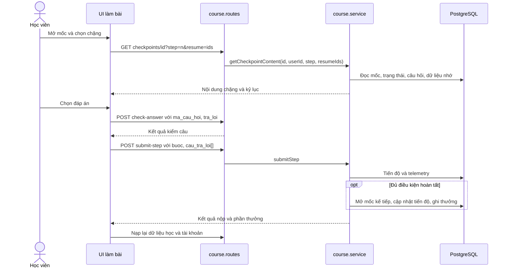
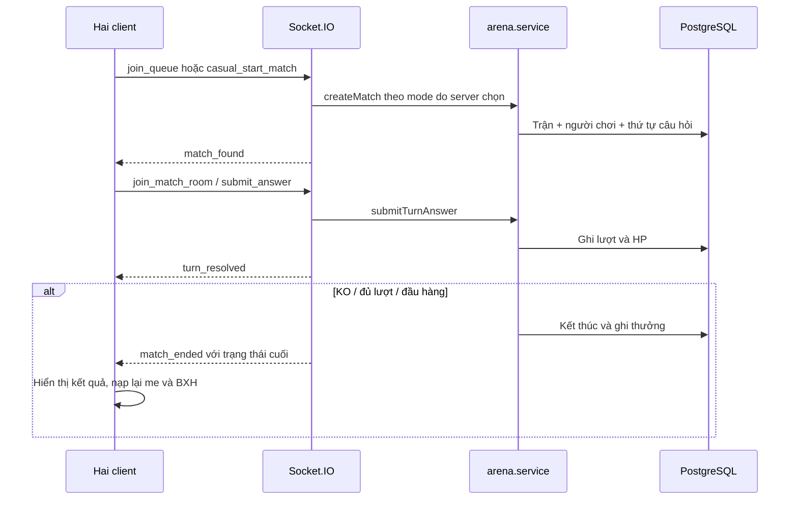

# 01 — Luồng chức năng

Đọc từ trái sang phải: thao tác → điểm vào → xử lý → nơi lưu/kết quả. Route đầy đủ nằm ở [API](03-api.md). “Local” đánh dấu bản sửa chưa lên Render.

## Tài khoản và cá nhân hóa

| Thao tác | Luồng và ghi dữ liệu | Nhánh cần kiểm tra |
|---|---|---|
| Mở web / tải lại | `initLiveBackend` đọc `tok_token` → `GET /api/auth/me` → xác thực JWT + phiên → `applyUserData` → nạp môn, pet, nhiệm vụ, BXH. Theme đọc sớm trước phần giao diện chính. | Token hết hạn hoặc sai phiên → đăng nhập lại. Không lấy trạng thái tài khoản cũ làm kết quả tải thành công. |
| Đăng ký | Form → `auth/register` → `auth.service.register` kiểm tra trùng và mật khẩu, hash bcrypt → tạo người học và dữ liệu ban đầu → token + DTO. | Trùng username/email, dữ liệu không hợp lệ, lỗi lưu. Tên hiển thị được lưu riêng với username. |
| Đăng nhập mật khẩu | `auth/login` → đối chiếu bcrypt → `issueSession` cập nhật streak theo ngày Việt Nam → DTO. FE điều hướng tài khoản quản trị theo vai trò. | Sai mật khẩu, tài khoản chỉ có Google, đăng nhập lặp trong cùng ngày. |
| Google | `google-signin.js` xin challenge theo mode → GIS trả credential → BE kiểm cookie challenge, CSRF, nonce, audience và email xác minh → tìm theo `google_sub` hoặc tạo tài khoản. | Email trùng tài khoản hiện hữu → đăng nhập mật khẩu rồi liên kết. Challenge hết hạn → mở lại. |
| Liên kết / bỏ Google | Cài đặt → `POST/DELETE auth/google/link` có JWT. Liên kết ràng buộc challenge với user hiện hành, kiểm Google ID đã thuộc tài khoản nào. | Tài khoản không có mật khẩu cần tạo mật khẩu trước khi bỏ phương thức đăng nhập duy nhất. |
| Quên mật khẩu | Nhập username → `password-recovery/lookup` → Gmail che bớt + lookup token. Xác minh đúng Google đã liên kết → proof đặt lại. Nhánh email gửi mã chỉ khả dụng khi cấu hình mail. `reset` đổi bcrypt hash, tăng `session_version`, tiêu thụ proof. | Tên không tồn tại hoặc chưa liên kết, Google sai, proof hết hạn hoặc đã dùng, vượt số lần thử. Không trả Gmail đầy đủ từ lookup. |
| Hồ sơ và mật khẩu | `PUT auth/account` đổi tên/username → DTO. `PUT auth/password` kiểm mật khẩu cũ hoặc phiên Google vừa xác thực khi tạo mật khẩu đầu tiên. | Kiểm trùng username, yêu cầu xác thực lại. Sau đổi mật khẩu, kiểm phiên cũ cả HTTP và socket. |
| Cài đặt | `PUT auth/settings` lưu theme/âm thanh/tiến độ tour → FE áp dụng preferences. Bộ tranh ngày lễ chọn riêng theo `tok-theme-art`, cảnh minh họa theo `tok-scenic-skin`. | Phân biệt preference đồng bộ tài khoản và lựa chọn chỉ ở thiết bị. Đăng xuất hoặc đổi tài khoản phải làm sạch trạng thái riêng. |
| Trang cá nhân | `personal-journey.js` mở trang hồ sơ → `GET /api/profile/journey` → tổng hợp mốc theo môn và phiên học 90 ngày → lịch hoạt động, tab môn, tiến độ. | Có trạng thái trống/lỗi. Số phiên học không phải số câu đúng hoặc kết luận điểm yếu. |
| Tour | `guided-tour.js` chọn kịch bản PC/mobile → xác định mục tiêu theo DOM → cuộn đến mục tiêu → chờ thao tác hoặc nút tiếp → lưu tiến độ. | Sidebar thu gọn, menu mobile, mục tiêu chưa mount, chế độ giảm chuyển động. Tour mở được từ Cài đặt. |

## Học tập

| Thao tác | Luồng và ghi dữ liệu | Nhánh cần kiểm tra |
|---|---|---|
| Kho môn / môn đang học | `GET /api/courses` trả catalog; `GET /api/my-courses` trả môn của tài khoản. `POST /courses/:slug/enroll` → `ensureCourseInitialized` tạo tiến độ môn và mốc đầu. | Môn sai slug, đã đăng ký, môn thiếu chương/mốc. |
| Mở bản đồ | `openCourseRoadmap` → `GET /courses/:slug` → ghép chương, mốc, trạng thái, kỷ lục → `renderLearningGarden`. Mỗi chương có đường riêng, bốn mùa lặp theo thứ tự chương. | Mốc khóa không bắt đầu bài. Pet đứng ở mốc hiện tại. Cảnh dùng theme đang chọn và tải gần vùng cuộn. |
| Xem chi tiết mốc | Bấm mốc → `openCheckpointModal` → số sao, độ chính xác, thời gian và lựa chọn xem lý thuyết/luyện chặng. `checkpoint-records.js` tính từ telemetry chặng đã nộp. | Thiếu dữ liệu hiện dấu trống, không tự suy ra 100%. Bản đồ và modal dùng cùng trạng thái mở khóa. |
| Lý thuyết | Lấy `GET /checkpoints/:id` → hiển thị thẻ nội dung. Mốc lý thuyết hoàn tất qua `POST complete-theory` → tiến độ mốc, mở mốc kế, tiến độ môn, Xu và EXP. | Local khóa user trong TX, mốc đã hoàn thành trả 0 thưởng. Bản cũ chưa có chốt này. |
| Luyện theo chặng | `getCheckpointContent` chọn bộ câu hỏi theo số câu, Bloom và dữ liệu nhớ. FE dựng câu trắc nghiệm, điền từ, nối cặp, sắp xếp. `check-answer` kiểm từng câu. | Mốc bị khóa, chặng sai, câu không thuộc bộ hợp lệ. Kiểm lại mốc Boss vì có đường chọn câu riêng. |
| Nộp chặng | `submit-step` → chấm, cập nhật bộ nhớ và `lich_su_phien_hoc` → cập nhật chặng → khi đủ điều kiện hoàn thành mốc thì mở mốc kế và cộng thưởng. | Ôn lại, đúng/sai sau lần thử, thời gian và tra cứu. Đọc chính sách trả thưởng tại nhánh cụ thể trong service. |
| Rời / khôi phục chặng | `abandon-step` lưu telemetry một phần và bộ nhớ; `lesson-state.js` quản lý snapshot để tiếp tục, có phạm vi tài khoản. | Partial không tương đương hoàn thành chặng. Kiểm tra đổi tài khoản, dữ liệu cũ và lần rời có câu trả lời. |
| Nộp cả mốc | `POST /checkpoints/:id/submit` → `submitQuizCheckpoint` là đường nộp toàn mốc riêng. | Khi sửa thưởng/mở khóa cần kiểm cả đường `submit` và `submit-step`. |

## Thi đấu và phần thưởng

| Thao tác | Luồng và ghi dữ liệu | Nhánh cần kiểm tra |
|---|---|---|
| Sảnh đấu hạng | Minigame → `selectArenaMode('ranked')` → `renderLobby` hiển thị môn, điểm môn và tổng. Bấm tìm → socket `join_queue` theo môn. | Hủy qua `leave_queue`. Sau chờ có nhánh ghép bot. Local chỉ trận ghép hai người thật được gắn RANKED. |
| Giao hữu | Chủ phòng tạo KEY → `casual_create_or_update_room` → bạn nhập KEY hoặc mở URL QR `?room=...` → `casual_join_room` → chủ phòng `casual_start_match`. | Phòng không tồn tại, đầy, sai chủ, rời phòng/mất kết nối. QR chỉ chứa URL mời. Phòng giữ trong RAM. |
| Đấu bot | Ghép bot sau timeout hoặc chọn đấu tập. BE lấy bot từ catalog và khởi tạo trận. | Bot chính thức có mã `usr_bot_`. Tránh lật ảnh bot nếu sprite đã hướng trái. Local mode PRACTICE không đổi điểm hạng. |
| Trong trận | `createMatch` ghi trận, 2 người chơi và bộ câu hỏi. `submit_answer` / REST `turn` → `submitTurnAnswer` kiểm đáp án, tính sát thương, ghi lượt và HP → `turn_resolved`. | Có logic HP/hiệu ứng cục bộ. Payload cũ còn chứa đáp án đúng. Xem review trước khi triển khai hạng thật. |
| Kết thúc / đầu hàng | KO, đủ lượt, đầu hàng hoặc mất kết nối → kết thúc trận → `match_ended`. Local khóa hàng trận, ghi kết quả + Xu/EXP + delta hạng cùng TX. UI lấy phần thưởng từ kết quả lưu. | Hòa, rời sớm, kết thúc gọi lại, socket và REST đến sát nhau. Local hai bên phải có lượt để nhận thưởng. |
| BXH | `GET /api/arena/leaderboard` → FE gom theo môn và tab hạng/tốc độ/chính xác/chuỗi. | Bản triển khai cũ dùng EXP cho hạng. Local đọc `diem_dau_hang` và thống kê trận đã xác nhận. Tên là display name, đánh dấu mình bằng ID. |
| Biểu cảm | `battle-reactions.js` gửi `match_reaction` với mã cố định → server xác thực thành viên trận, giới hạn tần suất → hiện cạnh pet. | Bot dùng biểu cảm cục bộ. Có tùy chọn tắt biểu cảm đối phương. |
| Cực hạn | `start` lấy bộ câu → `check-answer` → `next-batch` lấy tiếp → `finish` tổng hợp kết quả và thưởng, ghi phiên Cực hạn. | Chế độ có tim riêng. Không vào BXH đấu hạng mới. `finish` còn dựa vào log client, xem review. |
| Pet | `GET /api/pets` → mua `POST /pets/:id/buy` → ghi sở hữu và trừ Xu → trang Pet `equip` đổi cờ đang dùng → `me` nạp lại. | Kiểm cấp, đủ Xu, đã sở hữu, loại đặc quyền. Đồng bộ trang chủ, bản đồ và sảnh. |
| Chăm pet / nhiệm vụ | `POST /pets/care` → Xu/ghi giao dịch chăm. `quests-status` đọc hoạt động trong ngày Việt Nam. `claim-quest` xác nhận điều kiện và nhận một lần. | Quà tân thủ có endpoint riêng. FE phải lấy trạng thái đã nhận từ BE. |
| Phụ kiện / giao dịch | `/api/items` liệt kê catalog và sở hữu; mua → ghi sở hữu và trừ Xu; `PUT equipped` cập nhật phụ kiện. `economy/transactions` đọc sổ Xu. | Đeo cần sở hữu. Phụ kiện trang trí. Xu chi tiêu và EXP cấp độ là hai trường khác nhau. |

## Quản trị

`/admin/` là giao diện riêng. API `/api/admin` qua `requireAdmin`. Quản lý môn → chương → mốc → câu hỏi gồm CRUD và import câu hỏi. Quản lý người học gồm xem hồ sơ, vai trò, điều chỉnh Xu, nhật ký và telemetry. Danh mục pet có thao tác CRUD riêng. Khi chỉnh/xóa dữ liệu nội dung, kiểm quan hệ FK và tiến độ đã có. Khi điều chỉnh Xu, dùng service ghi sổ giao dịch. Pet Studio là bộ route khác dành cho xử lý tài nguyên, cần kiểm ranh giới truy cập riêng.

## Đọc sâu ba luồng dễ sửa nhầm

### Nộp chặng và cập nhật bản đồ

- `resume` là danh sách ID phân cách dấu phẩy. Server chọn/khôi phục bộ câu trong `getCheckpointContent`. Đừng coi lựa chọn client gửi là đáp án chuẩn.
- `submit-step` yêu cầu mảng `cau_tra_loi`. `abandon-step` yêu cầu mảng có ít nhất một phần tử. `submit` dùng mảng cho toàn mốc. Giữ riêng bốn thao tác kiểm câu, nộp chặng, lưu dở và nộp cả mốc khi sửa UI.
- `lich_su_phien_hoc.chi_tiet_cau_hoi` là JSON dạng text. Kỷ lục lấy lần trả lời đầu của từng câu trong phiên DUOLINGO_STEP, chọn phiên tỷ lệ đúng tốt nhất từng chặng rồi tổng hợp có trọng số theo số câu. Nếu có chặng thiếu thời gian hợp lệ, thời gian trung bình là null.
- Điểm kiểm lỗi: quyền mở mốc, dữ liệu câu theo dạng, xác nhận hoàn thành từ BE, số Xu/EXP thực nhận, vị trí mốc sau reload.

### Trận 1v1 và kết thúc

- WS dùng `ma_tran`, `thu_tu_cau`, `vi_tri_dap_an_chon`, `cau_tra_loi`, `thoi_gian_giay`. Identity lấy từ phiên socket. REST turn là đường dự phòng, không gửi cả hai cùng lúc.
- Với Local, `createMatch` nhận mode nội bộ. Request tạo trận thường không được tự gắn RANKED. `concludeIfResolved` đọc người chơi/HP/lượt đã lưu, không nhận người thắng do client đề xuất.
- `checkEnd` đọc trạng thái cuối, kiểm đúng ID trận rồi render. Nếu đổi view/tài khoản khi fetch chưa về, tránh callback cũ sửa DOM/state trận mới. Điểm hạng, Xu và EXP là ba giá trị độc lập.
- Khi debug, lần lượt kiểm map socket → mã trận → người chơi → câu/lượt → trạng thái cuối → ledger. Với lỗi ghép đội, kiểm thêm chủ phòng, mã phòng, người tham gia và quá trình cleanup khi disconnect.

### Phiên và khôi phục tài khoản

- Challenge Google có nonce, CSRF, mode, user ID (nếu cần) và hạn. Credential cần trùng audience, nonce, email xác minh và liên kết tương ứng. Google sub là định danh liên kết ổn định.
- Lookup khôi phục ràng buộc token với user ID và phiên hiện hành. Gmail che là thông tin để người dùng nhận diện, proof xác thực Google hoặc mã email hợp lệ mới cho phép đổi mật khẩu.
- Reset đọc proof, hạn và số lần thử; sai mã ghi lại số lần thử; thành công đổi hash, tăng phiên và xóa proof. JWT cũ phải bị từ chối ở cả middleware HTTP và socket. Lỗi dịch vụ gửi mail cần tách khỏi lỗi xác thực.
