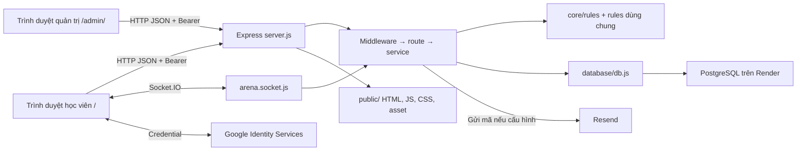

# 02 — Kiến trúc và ranh giới

- Một tiến trình Node phục vụ static, HTTP và socket trên cùng HTTP server. `public/index.html` chứa phần lớn UI và JS học viên. `public/admin/index.html` là app quản trị độc lập. Không có build frontend bắt buộc.
- `routes/` chuyển request sang service và ánh xạ lỗi. `services/` phụ trách truy vấn, TX và orchestration. `core/rules/` là quy tắc thuần về tiến độ, Bloom/ghi nhớ, streak, chiến đấu, kinh tế. `public/js/level-rules.js` dùng chung Node và FE.
- Adapter chọn PostgreSQL khi `DATABASE_URL` có scheme PostgreSQL. Nhánh MSSQL gọi `sqlcmd` và có hành vi TX khác. Profile journey dùng cú pháp PG. Khi đánh giá Render, lấy PG làm chuẩn.
- `server.js` cấu hình proxy trên Render, CORS, JSON/urlencoded 10 MB, formatter, static, route và lỗi cuối. Sau các init trước listen, telemetry và seed chương 1 chạy trễ. Vì vậy endpoint phụ thuộc bảng mới có thể gặp cửa sổ chưa sẵn sàng.
- `socket.data` và JWT/phiên dùng để nhận dạng. Hàng đợi, danh sách trận hoạt động, phòng giao hữu và timer bot ở RAM. Trận, người chơi, câu hỏi và lượt đã ghi nằm trong PG. Restart làm mất phần RAM. Không giả định nhiều instance tự chia sẻ queue.

## Ba lớp bằng chứng

| Lớp | Dùng để kết luận |
|---|---|
| Git `3762634` | Mốc đã triển khai sảnh sân vườn được kiểm ở lượt trước. Đọc bằng `git show 3762634:<path>`. |
| Working tree | Có thay đổi tách điểm hạng và TX thưởng lý thuyết. File mới gồm `database/init_arena_ranking.js`, `public/js/arena-rules.js` và test. Chưa xác nhận triển khai. |
| Runtime Render | HTTP, phiên đăng nhập, trạng thái Google/Resend, schema và bản ghi cần xác minh trực tiếp. Bằng chứng từ môi trường test chỉ dùng cho test. |

[Server](../../server.js) · [Adapter](../../database/db.js) · [Phiên](../../services/session-validity.service.js) · [Socket](../../sockets/arena.socket.js)
