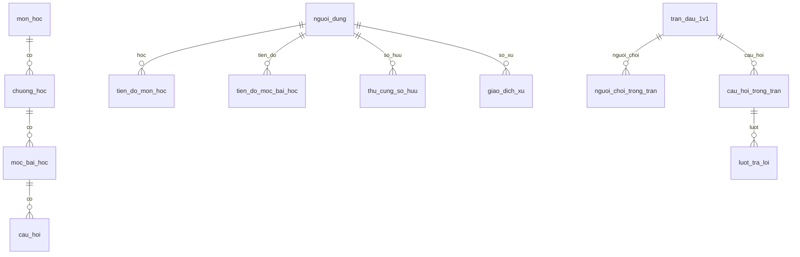

# 04 — Dữ liệu PostgreSQL

Schema dưới đây đọc từ DDL trong repo, không phải bản dump Render. Cột từ startup migration ở cuối. Xem [review](06-review.md) trước khi thay dữ liệu tài khoản hoặc điểm.

## Quan hệ chính



## DDL gốc và bảng bổ sung

Các khai báo giữ nguyên tên, kiểu, mặc định và ràng buộc để tra cứu.

### `nguoi_dung`

[database/migrations/001_postgres_initial_schema.sql:9](../../database/migrations/001_postgres_initial_schema.sql#L9)

```sql
    ma_nguoi_dung VARCHAR(50) PRIMARY KEY,
    ten_dang_nhap VARCHAR(50) NOT NULL UNIQUE,
    email VARCHAR(100) NOT NULL UNIQUE,
    mat_khau_hash VARCHAR(255) NOT NULL,
    ten_hien_thi VARCHAR(100) NOT NULL,
    khung_avatar VARCHAR(50) NOT NULL DEFAULT 'khung_khoi_dau',
    vai_tro VARCHAR(20) NOT NULL DEFAULT 'NGUOI_HOC',
    tong_diem_kinh_nghiem INT NOT NULL DEFAULT 0,
    xu_tri_thuc INT NOT NULL DEFAULT 100,
    chuoi_streak_ngay INT NOT NULL DEFAULT 0,
    ngay_hoat_dong_cuoi DATE NULL,
    che_do_giao_dien VARCHAR(10) NOT NULL DEFAULT 'TOI',
    bat_am_thanh BOOLEAN NOT NULL DEFAULT TRUE,
    tao_luc TIMESTAMPTZ NOT NULL DEFAULT NOW(),
    cap_nhat_luc TIMESTAMPTZ NOT NULL DEFAULT NOW()
```

### `thu_cung`

[database/migrations/001_postgres_initial_schema.sql:28](../../database/migrations/001_postgres_initial_schema.sql#L28)

```sql
    ma_thu_cung VARCHAR(50) PRIMARY KEY,
    ten_thu_cung VARCHAR(100) NOT NULL,
    mo_ta VARCHAR(500) NULL,
    anh_dai_dien VARCHAR(255) NULL,
    spritesheet_url VARCHAR(255) NULL,
    gia_xu INT NOT NULL DEFAULT 0,
    cap_do_yeu_cau INT NOT NULL DEFAULT 1,
    he_so_sat_thuong REAL NOT NULL DEFAULT 1.0,
    tao_luc TIMESTAMPTZ NOT NULL DEFAULT NOW()
```

### `thu_cung_so_huu`

[database/migrations/001_postgres_initial_schema.sql:41](../../database/migrations/001_postgres_initial_schema.sql#L41)

```sql
    ma_so_huu VARCHAR(50) PRIMARY KEY,
    ma_nguoi_dung VARCHAR(50) NOT NULL REFERENCES nguoi_dung(ma_nguoi_dung) ON DELETE CASCADE,
    ma_thu_cung VARCHAR(50) NOT NULL REFERENCES thu_cung(ma_thu_cung),
    dang_kich_hoat BOOLEAN NOT NULL DEFAULT FALSE,
    ngay_so_huu TIMESTAMPTZ NOT NULL DEFAULT NOW(),
    CONSTRAINT uq_nguoi_dung_thu_cung UNIQUE(ma_nguoi_dung, ma_thu_cung)
```

### `giao_dich_xu`

[database/migrations/001_postgres_initial_schema.sql:55](../../database/migrations/001_postgres_initial_schema.sql#L55)

```sql
    ma_giao_dich VARCHAR(50) PRIMARY KEY,
    ma_nguoi_dung VARCHAR(50) NOT NULL REFERENCES nguoi_dung(ma_nguoi_dung) ON DELETE CASCADE,
    so_luong INT NOT NULL,
    so_du_sau INT NOT NULL,
    nguon_giao_dich VARCHAR(50) NOT NULL,
    mo_ta VARCHAR(255) NULL,
    thoi_gian TIMESTAMPTZ NOT NULL DEFAULT NOW()
```

### `mon_hoc`

[database/migrations/001_postgres_initial_schema.sql:66](../../database/migrations/001_postgres_initial_schema.sql#L66)

```sql
    ma_mon VARCHAR(50) PRIMARY KEY,
    ten_mon VARCHAR(200) NOT NULL,
    slug VARCHAR(100) NOT NULL UNIQUE,
    mo_ta TEXT NULL,
    anh_bia VARCHAR(255) NULL,
    thu_tu INT NOT NULL DEFAULT 1,
    tao_luc TIMESTAMPTZ NOT NULL DEFAULT NOW()
```

### `chuong_hoc`

[database/migrations/001_postgres_initial_schema.sql:77](../../database/migrations/001_postgres_initial_schema.sql#L77)

```sql
    ma_chuong VARCHAR(50) PRIMARY KEY,
    ma_mon VARCHAR(50) NOT NULL REFERENCES mon_hoc(ma_mon) ON DELETE CASCADE,
    tieu_de VARCHAR(200) NOT NULL,
    thu_tu INT NOT NULL DEFAULT 1,
    mo_ta TEXT NULL,
    tao_luc TIMESTAMPTZ NOT NULL DEFAULT NOW()
```

### `moc_bai_hoc`

[database/migrations/001_postgres_initial_schema.sql:87](../../database/migrations/001_postgres_initial_schema.sql#L87)

```sql
    ma_moc VARCHAR(50) PRIMARY KEY,
    ma_chuong VARCHAR(50) NOT NULL REFERENCES chuong_hoc(ma_chuong) ON DELETE CASCADE,
    tieu_de VARCHAR(200) NOT NULL,
    loai_moc VARCHAR(30) NOT NULL,
    noi_dung_ly_thuyet TEXT NULL,
    diem_thuong INT NOT NULL DEFAULT 10,
    xu_thuong INT NOT NULL DEFAULT 5,
    thu_tu INT NOT NULL DEFAULT 1,
    tao_luc TIMESTAMPTZ NOT NULL DEFAULT NOW()
```

### `cau_hoi`

[database/migrations/001_postgres_initial_schema.sql:100](../../database/migrations/001_postgres_initial_schema.sql#L100)

```sql
    ma_cau_hoi VARCHAR(50) PRIMARY KEY,
    ma_moc VARCHAR(50) NULL REFERENCES moc_bai_hoc(ma_moc) ON DELETE SET NULL,
    noi_dung TEXT NOT NULL,
    loai_cau_hoi VARCHAR(30) NOT NULL DEFAULT 'TRAC_NGHIEM_4',
    dap_an_a TEXT NULL,
    dap_an_b TEXT NULL,
    dap_an_c TEXT NULL,
    dap_an_d TEXT NULL,
    vi_tri_dap_an_dung INT NULL,
    muc_bloom VARCHAR(20) NOT NULL DEFAULT 'NHO',
    buoc_luyen_tap INT NOT NULL DEFAULT 1,
    du_lieu_cau_hoi TEXT NULL,
    giai_thich TEXT NULL,
    do_kho INT NOT NULL DEFAULT 1,
    tao_luc TIMESTAMPTZ NOT NULL DEFAULT NOW()
```

### `tien_do_mon_hoc`

[database/migrations/001_postgres_initial_schema.sql:119](../../database/migrations/001_postgres_initial_schema.sql#L119)

```sql
    ma_tien_do_mon VARCHAR(50) PRIMARY KEY,
    ma_nguoi_dung VARCHAR(50) NOT NULL REFERENCES nguoi_dung(ma_nguoi_dung) ON DELETE CASCADE,
    ma_mon VARCHAR(50) NOT NULL REFERENCES mon_hoc(ma_mon) ON DELETE CASCADE,
    phan_tram_hoan_thanh REAL NOT NULL DEFAULT 0.0,
    ngay_bat_dau TIMESTAMPTZ NOT NULL DEFAULT NOW(),
    ngay_hoan_thanh TIMESTAMPTZ NULL,
    CONSTRAINT uq_nguoi_dung_mon UNIQUE(ma_nguoi_dung, ma_mon)
```

### `tien_do_moc_bai_hoc`

[database/migrations/001_postgres_initial_schema.sql:130](../../database/migrations/001_postgres_initial_schema.sql#L130)

```sql
    ma_tien_do_moc VARCHAR(50) PRIMARY KEY,
    ma_nguoi_dung VARCHAR(50) NOT NULL REFERENCES nguoi_dung(ma_nguoi_dung) ON DELETE CASCADE,
    ma_moc VARCHAR(50) NOT NULL REFERENCES moc_bai_hoc(ma_moc) ON DELETE CASCADE,
    trang_thai VARCHAR(20) NOT NULL DEFAULT 'DA_MO',
    diem_dat_duoc INT NOT NULL DEFAULT 0,
    xu_da_nhan INT NOT NULL DEFAULT 0,
    buoc_hien_tai INT NOT NULL DEFAULT 1,
    cac_buoc_hoan_thanh VARCHAR(50) NOT NULL DEFAULT '0/4',
    thoi_diem_hoan_thanh TIMESTAMPTZ NULL,
    CONSTRAINT uq_nguoi_dung_moc UNIQUE(ma_nguoi_dung, ma_moc)
```

### `tran_dau_1v1`

[database/migrations/001_postgres_initial_schema.sql:144](../../database/migrations/001_postgres_initial_schema.sql#L144)

```sql
    ma_tran VARCHAR(50) PRIMARY KEY,
    ma_mon VARCHAR(50) NULL REFERENCES mon_hoc(ma_mon) ON DELETE SET NULL,
    trang_thai VARCHAR(30) NOT NULL DEFAULT 'CHUAN_BI',
    thoi_gian_bat_dau TIMESTAMPTZ NOT NULL DEFAULT NOW(),
    thoi_gian_ket_thuc TIMESTAMPTZ NULL,
    nguoi_thang_cuoc VARCHAR(50) NULL REFERENCES nguoi_dung(ma_nguoi_dung),
    ly_do_ket_thuc VARCHAR(50) NULL
```

### `nguoi_choi_trong_tran`

[database/migrations/001_postgres_initial_schema.sql:155](../../database/migrations/001_postgres_initial_schema.sql#L155)

```sql
    ma_nguoi_choi_trong_tran VARCHAR(50) PRIMARY KEY,
    ma_tran VARCHAR(50) NOT NULL REFERENCES tran_dau_1v1(ma_tran) ON DELETE CASCADE,
    ma_nguoi_dung VARCHAR(50) NOT NULL REFERENCES nguoi_dung(ma_nguoi_dung),
    ma_thu_cung VARCHAR(50) NULL REFERENCES thu_cung(ma_thu_cung),
    mau_hien_tai INT NOT NULL DEFAULT 100,
    mau_toi_da INT NOT NULL DEFAULT 100,
    tong_sat_thuong_gay_ra INT NOT NULL DEFAULT 0,
    ket_qua VARCHAR(20) NOT NULL DEFAULT 'CHUA_KET_THUC',
    xu_nhan_duoc INT NOT NULL DEFAULT 0,
    exp_nhan_duoc INT NOT NULL DEFAULT 0,
    CONSTRAINT uq_tran_nguoi_dung UNIQUE(ma_tran, ma_nguoi_dung)
```

### `cau_hoi_trong_tran`

[database/migrations/001_postgres_initial_schema.sql:170](../../database/migrations/001_postgres_initial_schema.sql#L170)

```sql
    ma_cau_trong_tran VARCHAR(50) PRIMARY KEY,
    ma_tran VARCHAR(50) NOT NULL REFERENCES tran_dau_1v1(ma_tran) ON DELETE CASCADE,
    ma_cau_hoi VARCHAR(50) NOT NULL REFERENCES cau_hoi(ma_cau_hoi),
    thu_tu_cau INT NOT NULL,
    CONSTRAINT uq_tran_thu_tu UNIQUE(ma_tran, thu_tu_cau)
```

### `luot_tra_loi`

[database/migrations/001_postgres_initial_schema.sql:179](../../database/migrations/001_postgres_initial_schema.sql#L179)

```sql
    ma_luot_tra_loi VARCHAR(50) PRIMARY KEY,
    ma_cau_trong_tran VARCHAR(50) NOT NULL REFERENCES cau_hoi_trong_tran(ma_cau_trong_tran) ON DELETE CASCADE,
    ma_nguoi_choi_trong_tran VARCHAR(50) NOT NULL REFERENCES nguoi_choi_trong_tran(ma_nguoi_choi_trong_tran),
    vi_tri_dap_an_chon INT NULL,
    la_dap_an_dung BOOLEAN NOT NULL DEFAULT FALSE,
    thoi_gian_tra_loi_giay REAL NOT NULL DEFAULT 0.0,
    sat_thuong_gay_ra INT NOT NULL DEFAULT 0,
    thoi_diem_tra_loi TIMESTAMPTZ NOT NULL DEFAULT NOW(),
    CONSTRAINT uq_cau_nguoi_choi UNIQUE(ma_cau_trong_tran, ma_nguoi_choi_trong_tran)
```

### `lich_su_phien_hoc`

[database/init_telemetry.js:33](../../database/init_telemetry.js#L33)

```sql
        ma_phien VARCHAR(50) PRIMARY KEY,
        ma_nguoi_dung VARCHAR(50) NOT NULL REFERENCES nguoi_dung(ma_nguoi_dung) ON DELETE CASCADE,
        ma_moc VARCHAR(50) NOT NULL REFERENCES moc_bai_hoc(ma_moc) ON DELETE CASCADE,
        loai_phien VARCHAR(30) NOT NULL DEFAULT 'DUOLINGO_STEP',
        buoc_so INT NULL,
        thoi_gian_tong_giay REAL NOT NULL DEFAULT 0,
        ti_le_dung REAL NOT NULL DEFAULT 0,
        toc_do_trung_binh_giay REAL NOT NULL DEFAULT 0,
        tong_so_lan_tra_cuu INT NOT NULL DEFAULT 0,
        chi_tiet_cau_hoi TEXT NULL,
        tao_luc TIMESTAMPTZ NOT NULL DEFAULT NOW()
```

### `password_recovery`

[database/init_password_recovery.js:6](../../database/init_password_recovery.js#L6)

```sql
    user_id VARCHAR(100) PRIMARY KEY REFERENCES nguoi_dung(ma_nguoi_dung) ON DELETE CASCADE,
    email VARCHAR(255) NOT NULL, google_sub VARCHAR(255) NOT NULL,
    code_hash VARCHAR(64) NOT NULL, expires_at BIGINT NOT NULL,
    sent_at BIGINT NOT NULL, attempts INTEGER NOT NULL DEFAULT 0
```

## Cột thêm khi khởi động

| Nguồn | Thay đổi |
|---|---|
| [Identity](../../database/init_identity.js) | `nguoi_dung.google_sub`, `google_email`, `co_mat_khau`. Unique index cho Google sub khác NULL. |
| [Preferences](../../database/init_user_preferences.js) | JSON dạng text cho âm thanh và tiến độ tour. |
| [Inventory](../../database/init_inventory.js) | `phu_kien_dang_dung` và sở hữu phụ kiện. |
| [Recovery](../../database/init_password_recovery.js) | `session_version` và proof/mã khôi phục có hạn. |
| [Telemetry](../../database/init_telemetry.js) | Bộ nhớ từng mốc, số chặng/câu và cấu hình Bloom, chuỗi thắng, chỉnh kiểu phần trăm. |
| [Ranking local](../../database/init_arena_ranking.js) | `tran_dau_1v1.che_do` mặc định UNCLASSIFIED, `nguoi_choi_trong_tran.diem_hang_thay_doi`, bảng `diem_dau_hang` có PK (user, môn), điểm không âm. |

## Bảng bổ sung — tra nhanh

| Bảng | Cột và ràng buộc |
|---|---|
| `vat_pham_so_huu` | `ma_so_huu VARCHAR(50) PK`, `ma_nguoi_dung VARCHAR(50) FK ON DELETE CASCADE`, `ma_vat_pham VARCHAR(50) NOT NULL`, `ngay_so_huu TIMESTAMPTZ DEFAULT NOW()`. Unique user + vật phẩm. |
| `password_recovery` | `user_id VARCHAR(100) PK/FK ON DELETE CASCADE`, `email VARCHAR(255)`, `google_sub VARCHAR(255)`, `code_hash VARCHAR(64)`, `expires_at BIGINT`, `sent_at BIGINT`, `attempts INTEGER DEFAULT 0`. Hai mốc thời gian là epoch mili giây. |
| `diem_dau_hang` (local) | `ma_nguoi_dung VARCHAR(50)` và `ma_mon VARCHAR(50)` là FK, đều cascade khi xóa bản ghi cha. PK kép; `diem INT DEFAULT 0 CHECK(diem>=0)`. |

## Đọc từ giao diện xuống cột

| Hiển thị | Đọc từ | Ghi tại |
|---|---|---|
| Tên và nhãn Bạn | `ten_hien_thi`, so ID `ma_nguoi_dung` | Đăng ký, Google tạo mới, chỉnh tài khoản |
| Pet đồng hành | `thu_cung_so_huu.dang_kich_hoat` nối `thu_cung` | Trang Pet gọi equip |
| Cấp/EXP | `tong_diem_kinh_nghiem` → LevelRules | Học, trận, nhiệm vụ, Cực hạn |
| Ví | `xu_tri_thuc`; lịch sử từ `giao_dich_xu` | Các service kinh tế, mua/chăm và thưởng |
| Môn đang học | `tien_do_mon_hoc` nối `mon_hoc` | Đăng ký và cập nhật tiến độ |
| Chặng và mốc | `tien_do_moc_bai_hoc` + cấu hình `moc_bai_hoc` | Hoàn thành lý thuyết, nộp chặng/toàn mốc |
| Kỷ lục / lịch học | `lich_su_phien_hoc` | Ghi phiên ở service học tập và Cực hạn |
| Điểm hạng mới | `diem_dau_hang` + delta ở dòng người chơi | Kết thúc trận RANKED hợp lệ |
| Google và phiên | `google_sub`, `google_email`, `co_mat_khau`, `session_version` | Luồng đăng nhập/liên kết/đổi mật khẩu |

## Quy ước khi truy vấn

- ID dạng chuỗi, không mặc định là số. Dùng tham số thay vì nối giá trị vào SQL. Chú ý `COUNT` PostgreSQL có thể về chuỗi.
- Mốc ngày của streak/quest và lịch hồ sơ dùng ngày Việt Nam. Phân biệt DATE lịch với TIMESTAMPTZ và epoch mili giây. Không dùng ngày UTC để suy ra lần nhận nhiệm vụ.
- JSON ở `du_lieu_cau_hoi`, `du_lieu_tri_nho`, `chi_tiet_cau_hoi`, âm thanh/tour cần xử lý dữ liệu trống hoặc legacy. Trường tồn tại trong DB không đồng nghĩa đang được FE hiển thị.
